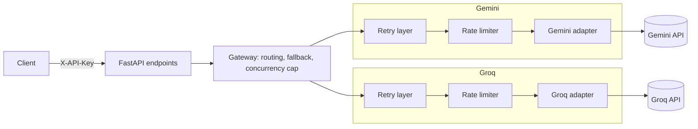

# llm-gateway


One HTTP API in front of multiple LLM providers (Google Gemini and Groq). It gives callers a
single request/response format for **text, structured output, and tool calling**, and handles
the unglamorous parts of production LLM use: **retries, rate limits, provider fallback, and
concurrent batching**.

I built it as a learning project to understand these pieces properly rather than call an SDK
and hope. It runs entirely on free-tier API keys.

## Features

- **One request shape, two providers.** Callers don't deal with Gemini's or Groq's SDK differences.
- **Structured output.** Pass a JSON Schema and get back a validated `parsed` object.
- **Tool calling.** Pass tool specs, get normalized tool calls back, send results in a follow-up turn.
- **Retries with exponential backoff and jitter**, honoring the provider's own `Retry-After` hint.
- **Client-side rate limiting** (requests/min and estimated tokens/min) so free-tier limits are
  respected instead of hit.
- **Automatic fallback** to the other provider when the first one is down or rate limited.
- **Concurrent batching** (`/v1/batch`) with a global concurrency cap and per-item errors.
- **API-key authentication**, typed request/response models (Pydantic), OpenAPI docs at `/docs`.
- **Tested without network access** (fake providers, fake clocks), type-checked in strict mode,
  linted, containerized, and checked in CI on every push.

## Quick start

You need free API keys from [Google AI Studio](https://aistudio.google.com/apikey) and the
[Groq console](https://console.groq.com/keys). One provider is enough; two enables fallback.

```bash
git clone https://github.com/Remy-mjcf/llm-gateway.git
cd llm-gateway

# Create the venv and install the package with dev tools (Python 3.12+)
uv venv --python 3.12 && source .venv/bin/activate
uv pip install -e ".[dev]"

# Configure: copy the template, then fill in keys, model names, and a gateway key
cp .env.example .env
python -c "import secrets; print(secrets.token_urlsafe(32))"   # use as GATEWAY_API_KEYS

uvicorn llm_gateway.api:app --reload
```

Interactive docs are at <http://localhost:8000/docs>.

### With Docker

```bash
docker build -t llm-gateway .
docker run --rm -p 8000:8000 --env-file .env llm-gateway
```

API keys are passed as environment variables at run time and never baked into the image. The
container runs as a non-root user and has a healthcheck on `/health`.

## Using the API

Every `/v1/*` call needs an `X-API-Key` header (`/health` is open). The examples assume
`export KEY=<your GATEWAY_API_KEYS value>`.

**Plain text**

```bash
curl -s http://localhost:8000/v1/generate \
  -H "X-API-Key: $KEY" -H "Content-Type: application/json" \
  -d '{"messages": [{"role": "user", "content": "Say hi in five words."}]}'
```

The response is the same shape whichever provider answered:

```json
{
  "provider": "gemini",
  "model": "...",
  "message": {"role": "assistant", "content": "..."},
  "parsed": null,
  "usage": {"input_tokens": 9, "output_tokens": 12, "reasoning_tokens": 0},
  "latency_ms": 840.2,
  "attempts": 1,
  "failed_providers": []
}
```

`attempts` shows how many tries the answering provider needed, and `failed_providers` lists any
providers that were tried first and failed (that is how a fallback is made visible).

**Structured output**: add a `response_schema` and read `parsed`:

```json
{
  "messages": [{"role": "user", "content": "Ada Lovelace was born in 1815."}],
  "response_schema": {
    "type": "object",
    "properties": {"name": {"type": "string"}, "birth_year": {"type": "integer"}},
    "required": ["name", "birth_year"]
  }
}
```

**Tool calling**: add `tools`. If the model wants one, `message.tool_calls` lists it. Run the
tool yourself and send the result back as a `tool` message with `tool_results`. Tools and
`response_schema` can't be combined in one request (the API returns 422).

**Batches**: `POST /v1/batch` with `{"requests": [...]}` (1 to 50 items). Items run
concurrently up to the gateway's cap, results come back in order, and one failing item never
fails the batch.

**Errors** always look like `{"error": {"type": "...", "message": "...", "provider": "..."}}`:

| Status | Meaning |
|---|---|
| 400 | The provider rejected the request as invalid, or you pinned a provider that isn't configured |
| 401 | Missing or invalid `X-API-Key` |
| 422 | The request body failed validation |
| 429 | Rate limited; includes a `Retry-After` header |
| 502 | Upstream credentials or model output were bad (not the caller's fault) |
| 503 | Providers are temporarily unavailable (`failures` lists each provider's error when all failed) |

`GET /v1/stats` reports calls, failures, and token totals per provider since startup.

## Architecture



Each provider is a stack of small layers that all share one `Provider` interface (a single
`async generate()` method), so each layer can wrap any other and be tested alone:

1. **Adapter** (`providers/`): translates between the common models and one SDK, and maps every
   SDK error to the gateway's own error types. Adapters never retry and never leak SDK exceptions.
2. **Rate limiter** (`ratelimit.py`): reserves a time slot before each call so requests are spaced
   under the per-minute limits.
3. **Retry layer** (`retry.py`): retries retryable errors with exponential backoff and jitter.
4. **Gateway** (`client.py`): picks the provider order, falls back, caps total concurrency, and
   keeps statistics.

## Design decisions

- **Adapters don't retry; one layer does.** Retries inside the SDKs would multiply (an SDK doing 3
  tries inside a gateway doing 4 is 12 calls) and hide behavior from the tests. The SDK clients are
  configured with retries off.
- **The rate limiter sits *inside* the retry layer.** A retry is a real request that counts against
  the provider's quota, so each retry waits for its own slot.
- **Errors are classified once, at the adapter.** `RetryableError` (rate limits, 5xx, malformed
  output), `NonRetryableError` (bad request, bad key). Everything above only handles those types.
- **Honor the provider's retry hint, but give up if it's too long.** If a 429 says "retry in 3600
  seconds" (a daily quota), sleeping is useless, so the retry layer stops and the gateway falls
  back to the other provider.
- **Fallback rules:** fall back on provider-side problems (retries exhausted, bad credentials). Do
  *not* fall back on an invalid request (it would likely fail again), and never fall back when the
  caller pinned a provider.
- **Fail closed on authentication.** With no `GATEWAY_API_KEYS`, the server refuses to start; running
  open takes an explicit `GATEWAY_AUTH_DISABLED=true`.
- **Fake time in tests.** The limiter and retry layer take injectable clock and sleep functions, so
  the retry and rate-limit tests run in milliseconds and are deterministic.
- **Tools and structured output are mutually exclusive.** It's a limit on one provider's models, so
  the common API enforces it for both. Behavior stays the same whichever provider answers.

## Provider differences the gateway hides

As of November 2026, with `google-genai` 2.34.0 and the OpenAI SDK pointed at Groq. Providers
change, so check their docs.

| Concern | Gemini | Groq |
|---|---|---|
| SDK | `google-genai` | `openai`, with Groq's `base_url` |
| Structured output | `response_json_schema` | strict `json_schema` (needs `additionalProperties: false` on every object, which the adapter adds) |
| Reasoning control | `thinking_level` (Gemini 3 models only) | `reasoning_effort` |
| Tool-call IDs | none (the adapter generates them) | provided |
| Multi-turn tool use | the model's previous turn must be echoed back (thought signatures) | standard |
| Usage accounting | adapter derives output tokens as total minus input minus reasoning | `completion_tokens` already includes reasoning |
| Bad API key | arrives as HTTP 400 | HTTP 401 |
| Retry hint | `retryDelay` inside the error details | `Retry-After` header |

## Configuration

Everything is configured through environment variables (a local `.env` is loaded in development).
`.env.example` documents every setting.

| Variable | Purpose | Default |
|---|---|---|
| `GATEWAY_API_KEYS` | Accepted caller keys, comma-separated (min 16 characters each) | required |
| `GATEWAY_AUTH_DISABLED` | `true` turns authentication off (development only) | unset |
| `GEMINI_API_KEY`, `GEMINI_MODEL` | Enables the Gemini provider | unset |
| `GROQ_API_KEY`, `GROQ_MODEL`, `GROQ_BASE_URL` | Enables the Groq provider | unset |
| `*_REQUESTS_PER_MINUTE`, `*_TOKENS_PER_MINUTE` | Client-side limits per provider (0 disables) | see `.env.example` |
| `LLM_MAX_RETRIES` | Total tries per provider, including the first | 4 |
| `LLM_TIMEOUT_SECONDS` | Per-request timeout | 30 |
| `LLM_MAX_CONCURRENCY` | Simultaneous in-flight requests | 3 |
| `LLM_DEFAULT_PROVIDER`, `LLM_ENABLE_FALLBACK` | Which provider is tried first, and whether to fall back | first configured, true |

## Development

```bash
ruff check . && ruff format --check .   # lint and formatting
mypy                                     # strict type checking of src/
pytest                                   # 100+ tests, no network or API keys needed
```

Tests run the real Gateway and API over fake providers, so routing, retries, rate limiting,
fallback, batching, and error mapping are all exercised offline. GitHub Actions runs the same
checks on every push, then builds the Docker image, starts it, and verifies the healthcheck and
that authentication is enforced.

`scripts/` has small smoke tests for hitting the real providers with your own keys, and
`notebooks/` has the step-by-step explorations the project grew out of.

```
src/llm_gateway/
  models.py      common request/response models
  errors.py      error hierarchy (retryable vs not)
  providers/     Gemini and Groq adapters
  ratelimit.py   spacing rate limiter
  retry.py       backoff with jitter
  client.py      the Gateway (routing, fallback, batching)
  config.py      settings from environment variables
  auth.py        API-key checking
  api.py         FastAPI app
```

## Known limitations

This is a learning project, and these are the gaps I know about:

- **Authentication is one shared key per caller.** There are no per-key quotas, revocation list, or
  hashed key storage. `/docs` and `/openapi.json` are open (they expose no data).
- **Rate limiting is per process.** Several workers or replicas would each have their own limiter.
  Daily quotas aren't tracked, only per-minute limits, and token limiting uses an estimate.
- **No circuit breaker.** If the default provider is down, every request still tries it first (and
  waits through its retries) before falling back.
- **A request holds a concurrency slot while it is backing off**, which can reduce throughput.
- **Multi-round tool loops over HTTP are unreliable on Gemini 3 models.** The provider-specific
  turn state needed for the next round isn't serialized over HTTP. Pin `"provider": "groq"` for
  tool loops. A fallback in the middle of a tool loop can also be rejected by the new provider.
- **Statistics are in memory** and reset when the server restarts.

## License

MIT. See [LICENSE](LICENSE).
